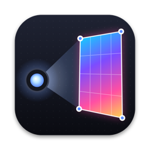
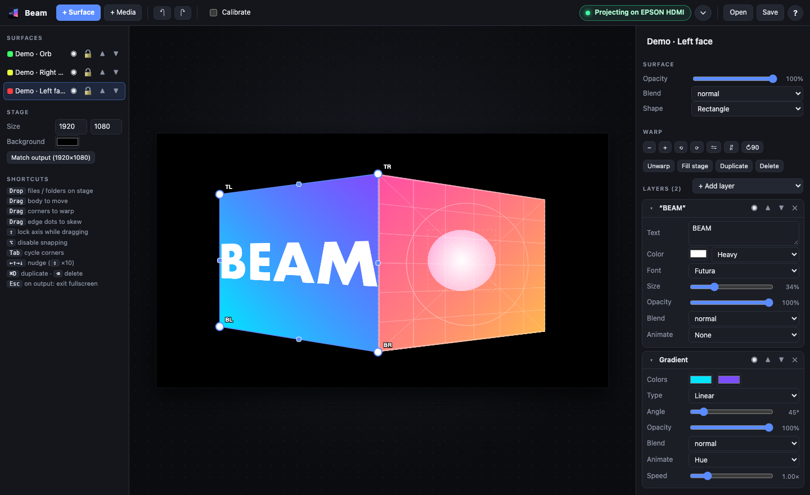
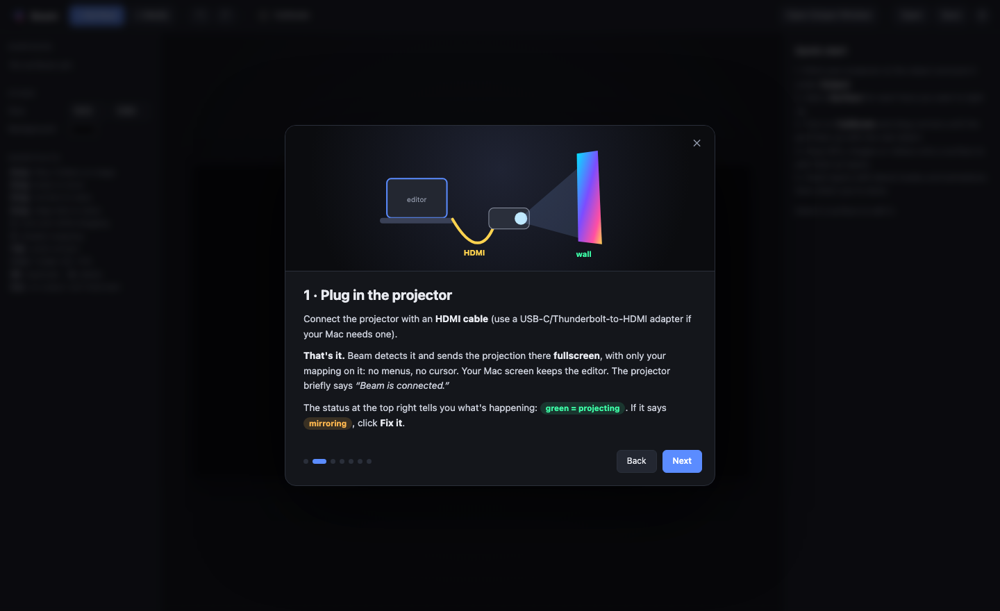
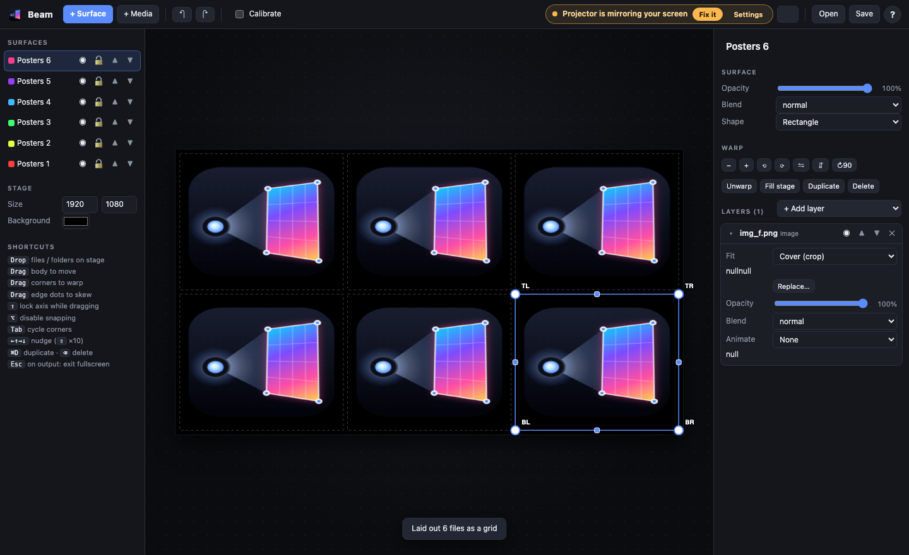

<p align="center">
  
</p>

<h1 align="center">Beam</h1>

<p align="center">
  <b>Free, open-source projection mapping software for Mac.</b><br>
  Plug in a projector. Drag some corners. Make your walls do things.<br>
  <sub>Built out of pure, distilled spite for $50/month subscriptions.</sub>
</p>

<p align="center">
  <a href="https://github.com/hord-brayden/beamy-goodness/releases/latest/download/Beam.dmg"><b>⬇️ Download Beam.dmg</b></a>
  &nbsp;·&nbsp; macOS 12+ &nbsp;·&nbsp; Apple Silicon & Intel &nbsp;·&nbsp; 2.7 MB &nbsp;·&nbsp; $0.00 forever
</p>

<p align="center">
  
</p>

---

## Why does this exist?

I wanted to point a projector at some boxes and put GIFs on them. A very normal desire.

The internet's answer was apparently **"that'll be $50 a month, please."** Or a few hundred dollars for a license, with a UI that looks like it was designed to land the space shuttle. Want to warp a rectangle? Enterprise tier. Want to play a GIF? Have you considered our Pro Ultra Max plan?

So I made **Beam**. It does the thing. It's free. It fits in 2.7 MB, which is smaller than most of the GIFs you're going to project with it.

## What it does

- 🎯 **Corner-pin perspective warping.** Drag the four corners of a surface onto the four corners of a real thing. Done. That's projection mapping.
- 🔌 **Plug-and-play HDMI.** Plug in the projector and Beam takes it over fullscreen with *only* your mapping on it: no menus, desktop or cursor. Your laptop keeps the editor. Unplug, replug, and it figures it out.
- 🪞 **One-click mirroring fix.** macOS mirroring your screen to the projector? Beam notices and gives you a **Fix it** button. You will never again open System Settings → Displays in a panic five minutes before showtime.
- 🖼️ **GIFs, videos, images.** Drag them in from Finder. GIF, MP4, MOV, WebM, PNG, JPG, HEIC, WebP. They loop. They're GPU-accelerated. They just work.
- 📂 **Drop a whole folder.** Drop it on empty space for an instant grid of surfaces, or onto a surface for a crossfading **playlist**.
- 🧅 **Layers & blend modes.** Stack color, gradients, media, playlists, text and calibration grids. Screen, multiply, overlay, difference, the works.
- ✨ **Built-in effects.** Pulse, strobe, flicker, hue cycle, spin, breathe, slide. Make a still JPEG feel like a rave.
- 📐 **Calibration grid.** Projects a numbered grid and circle onto every surface. Circle looks round on the wall? You nailed it.
- 🧲 **Snapping, nudging, locking.** Corners snap to neighbours so box faces meet perfectly. Arrow keys nudge by 1px. Lock surfaces when they're perfect.
- 😴 **Keeps your Mac awake** while projecting, so the screensaver doesn't kick in mid-show.
- 🎓 **Built-in tutorial and demo scene.** You'll be mapping in about two minutes.
- 💾 **Autosave**, undo/redo, and plain JSON project files.

<p align="center">
  
  
</p>

## Install

### Option A: the one-liner (easiest)
```bash
curl -fsSL https://raw.githubusercontent.com/hord-brayden/beamy-goodness/main/install.sh | bash
```
It downloads the latest release, puts **Beam** in your Applications folder and opens it. No security pop-ups. ([Read the script](install.sh) first if you like. It's short and only touches `/Applications/Beam.app`.)

### Option B: the DMG
1. **[Download Beam.dmg](https://github.com/hord-brayden/beamy-goodness/releases/latest/download/Beam.dmg)**, open it, and drag **Beam** to **Applications**.
2. The first time you open it, macOS will say it *"can't verify"* Beam. That's because I didn't pay Apple $99/year for the privilege, not because anything's wrong. Go to **System Settings → Privacy & Security**, scroll down and click **Open Anyway**. You only do this once.

## Use it (the whole manual)

1. **Plug the projector in over HDMI.** Use a USB-C → HDMI adapter if your Mac is HDMI-less. Beam goes fullscreen on it and the status light turns green.
2. **Click `+ Surface`.** Make one for each thing, or each face of a thing, you want to light up.
3. **Turn on `Calibrate`.** Look at the *wall, not your laptop*, and drag the white corner dots onto the real corners until the grid sits flat and the circle looks round.
4. **Drag GIFs, videos or images onto a surface.** Several files or a folder become a playlist.
5. **Turn off Calibrate.** You are now a projection mapping artist. Put it on your LinkedIn.

| Do this | How |
|---|---|
| Bend into perspective | Drag a corner dot |
| Skew one side | Drag an edge square |
| Move | Drag the middle |
| Pixel-perfect | `Tab` picks a corner, arrow keys nudge (`⇧` = 10px) |
| Stop snapping | Hold `⌥` while dragging |
| Get out of fullscreen | `Esc` |
| Tutorial | `?` button or **Help → Beam Tutorial** |

## Build from source

```bash
git clone https://github.com/hord-brayden/beamy-goodness.git
cd beamy-goodness
./build.sh      # → build/Beam.app
./package.sh    # → build/Beam.dmg
```
All you need is Xcode Command Line Tools (`xcode-select --install`). No npm, CocoaPods or 400 MB of `node_modules`. The whole thing is one Swift file plus some HTML/JS/CSS.

### How it works (for the nerds)
- `Sources/main.swift` is the native AppKit shell. It runs two WebKit views (the editor and the output), detects display hot-plugs, unmirrors, keeps the display awake, and handles Finder drag-and-drop and file pickers.
- `web/app.js` is the mapping engine. Each surface is a `<div>` with a CSS `matrix3d` homography computed from its four corners, so all the warping happens on the GPU and GIFs and videos play natively, with zero custom rendering code.
- Playlists pick the current item from the wall clock, so the editor preview and the projector stay in sync for free.
- Media is referenced by path, not copied. If you move your files, use **Replace…** on the layer.

## Contributing

PRs welcome! Ideas that would be great:
- Mesh warping for curved surfaces
- Soft-edge masks and edge blending for multi-projector setups
- MIDI / OSC triggers and scene switching
- Audio-reactive effects
- Bundling media with project files

Keep it simple. The whole point is that a normal human can use it.

## License

[MIT](LICENSE). Use it for your art installation, your church stage, your Halloween house, your bar, your startup launch party, your cat's birthday. No subscription required, ever.

---

<sub><b>Keywords</b> (hi, search engines 👋): free projection mapping software for Mac · open source projection mapping · macOS video mapping app · projector mapping tool · free MadMapper alternative · free HeavyM alternative · free Resolume Arena alternative · free Millumin alternative · corner pin / keystone / perspective warp · projection mapping GIFs · building projection · stage visuals · VJ software Mac · Halloween projection · holiday window projection · event projection mapping · DIY projection mapping · projector HDMI fullscreen output Mac.</sub>
